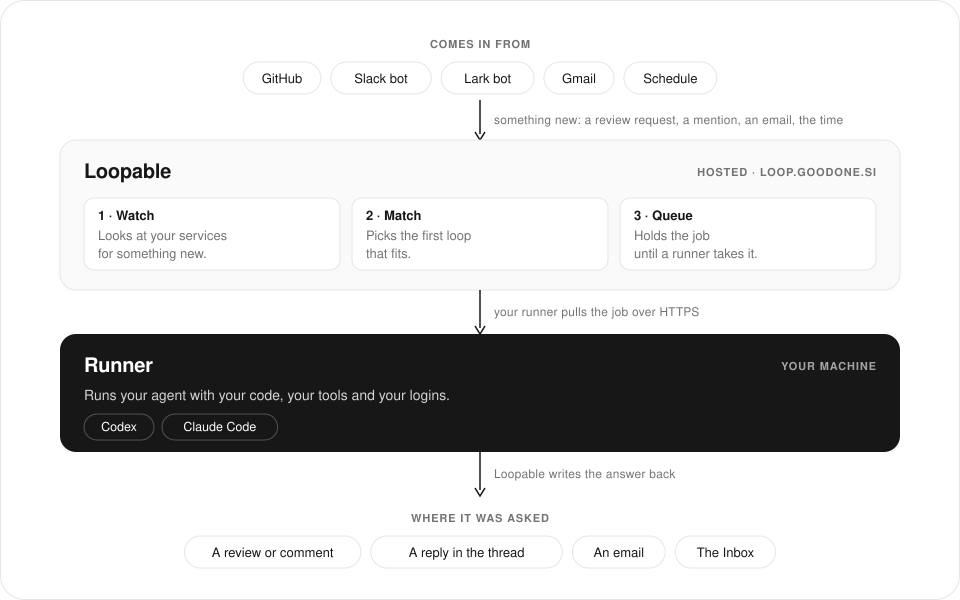

# Loopable

Workflows for the coding agent you already have. Set them up at [loop.goodone.si](https://loop.goodone.si); they run on your machine.

A review request, a question in #oncall, a morning check: today each one waits until you copy it into your agent, and when you are busy or away, it stops. Hosted agents can take some of it, but they run in a cloud sandbox that cannot reach your internal network, logs, or services.

Loopable watches GitHub, Slack, Lark, email, and the clock, and hands each job to Codex, Claude Code, or Cursor Agent on your own machine. The answer goes back where it was asked, and every run is recorded.

- **On its own.** A loop says what starts it, what to ask, and where to answer. Nobody has to be there.
- **On your machine.** The agent reaches what your machine reaches, uses the MCP servers and skills you installed, and runs on the plan you already pay for.
- **For your team too.** Answer in a team channel or on a shared GitHub account, and the same loop works for everyone.

The story is in [docs/narrative.md](docs/narrative.md). The words for the parts — trigger, workflow, loop, runner — are in [docs/concepts.md](docs/concepts.md).

## Get started

1. Sign in at [loop.goodone.si](https://loop.goodone.si) with GitHub or Google.
2. Connect your machine. It needs Node 22+ and Codex, Claude Code, or Cursor Agent signed in.

   ```bash
   npm install -g loopable-cli
   loopable runner --token <from the Runners page>
   ```

3. Connect GitHub, a Slack bot, or a Lark bot, and turn on a loop.

More machines, folders, and upgrading are in [docs/runners.md](docs/runners.md).

## Loops you can run today

| Comes in from | Loop | Writes back |
| --- | --- | --- |
| Any trigger | Custom loop: pick what starts it, write your own prompt | Anywhere below, or Inbox only |
| Schedule | Do something on a schedule | Inbox, or a Slack, Lark, or GitHub thread |
| GitHub | Review pull requests | A review, as a comment |
| GitHub | Reply to issues | A comment on the issue |
| Slack bot | Do what I ask the Slack bot (@mention or DM) | A reply in the thread |
| Feishu / Lark bot | Do what I ask the Feishu / Lark bot (@mention in a group) | A reply in the thread |
| WeChat | Do what I ask the WeChat bot | A reply in the chat |
| Gmail | Custom loop: “An email arrives” | Anywhere, such as an email back to the same inbox |

A loop’s answer can go to any connector that accepts it, so a scheduled check can post to #oncall. To ask an agent something once, use **Ask an agent** in the inbox.

## How it works

<p align="center">
  
</p>

Loopable is hosted: the app and the dispatcher run on Cloudflare. The dispatcher watches your services, matches a loop, and queues the job. Your runner pulls it over HTTPS, runs the agent on your machine, and Loopable writes the answer back.

| Part | Where | Does |
| --- | --- | --- |
| **App** | Hosted | The pages, sign-in, the API runners pull from |
| **Dispatcher** | Hosted | Watches for signals, matches loops, queues jobs, writes back |
| **Runner** | Your machine | Pulls a job, runs the agent CLI |

Your code, logs, and network access stay on your machine. Connection tokens are encrypted in the service, and the agent never sees them. Everything you set up belongs to your workspace, and nothing reads across workspaces.

## Develop

TanStack Start (React + Vite), SQLite (libSQL hosted), Tailwind. Tests are Vitest.

```bash
pnpm install
pnpm dev            # App + Dispatcher + Runner on one machine, ~/.loopable-dev, hot reload
pnpm typecheck
pnpm test
pnpm db:generate    # after changing src/server/db/schema.ts
pnpm db:studio
```

`pnpm dev` is a single local workspace with no sign-in. To try sign-in, workspaces, and joining a runner with a token locally, see [docs/hosting.md](docs/hosting.md#trying-hosted-mode-locally). `pnpm runner` is only for a second machine while `pnpm dev` is running.

### Release and deploy

CI runs typecheck, tests, and the build on every pull request and on `main`.

- **The CLI** (`loopable-cli` on npm): run the **Release** workflow in GitHub Actions with `patch`, `minor`, `major` or an exact version. It checks everything, bumps, tags `vX.Y.Z`, publishes to npm through trusted publishing (no npm token), pushes, and writes the release notes. `pnpm release` still does the same from a laptop signed in to npm.
- **The service**: run the **Deploy** workflow in GitHub Actions. Setup and the domain are in [docs/hosting.md](docs/hosting.md).

| Path | Contents |
| --- | --- |
| `src/connectors/` | One folder per connector: `manifest.ts` (browser-safe) and `runtime.ts` (server) |
| `src/agents/` | One folder per agent, same split |
| `src/server/` | Database, accounts, workspaces, secrets, queue, server functions |
| `src/dispatcher/` | Dispatcher process |
| `src/runner/` | Runner process |
| `src/routes/` | Pages and `/api/` |
| `src/landing/` | The front page |
| `src/worker.ts` | The Cloudflare Worker and its dispatcher container |
| `site/` | The old site address, now a redirect to loop.goodone.si |
| `drizzle/` | Migrations |

A new connector is a folder plus one line in `src/connectors/manifests.ts` and `src/connectors/runtimes.ts`. See [docs/connectors.md](docs/connectors.md).
